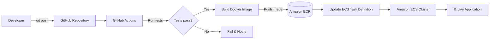

# 🚀 Automated CI/CD Pipeline with GitHub Actions, Docker, AWS ECR & ECS

A fully automated DevOps pipeline that takes code from `git push` to production with **zero manual deployment steps**.

Every code change is **automatically tested, built, containerized, and deployed** to AWS ECS, typically live within minutes.

🔗 **Project walkthrough:** [View on LinkedIn]([https://lnkd.in/eUiUPysX](https://lnkd.in/p/gQCeQzsi))

---

## 📌 Table of Contents

- [Overview](#-overview)
- [Architecture](#-architecture)
- [Tech Stack](#-tech-stack)
- [How the Pipeline Works](#-how-the-pipeline-works)
- [Project Structure](#-project-structure)
- [Prerequisites](#-prerequisites)
- [Setup Guide](#-setup-guide)
- [GitHub Actions Workflow](#-github-actions-workflow)
- [Key Learnings](#-key-learnings)
- [Future Improvements](#-future-improvements)

---

## 🔍 Overview

This project demonstrates an end-to-end CI/CD workflow that removes manual steps from the release process:

- ✅ Automated testing and building on every push
- ✅ Containerized application using Docker
- ✅ Secure image storage in Amazon ECR
- ✅ Production deployment on Amazon ECS
- ✅ Consistent, repeatable, and fast releases

---

## 🏗️ Architecture



---

## 🧰 Tech Stack

| Category | Technology |
|----------|------------|
| Version Control | Git, GitHub |
| CI/CD | GitHub Actions |
| Containerization | Docker |
| Image Registry | Amazon ECR |
| Orchestration / Hosting | Amazon ECS |
| Cloud Provider | AWS |

---

## ⚙️ How the Pipeline Works

1. **Push code**: A developer pushes changes to the `main` branch.
2. **Test & build**: GitHub Actions runs automated tests and builds the Docker image.
3. **Store image**: The image is tagged and pushed to a private **Amazon ECR** repository.
4. **Update task definition**: The ECS task definition is updated with the new image.
5. **Deploy**: The **ECS service** rolls out the new version to the production cluster.
6. **Live**: The application is running in production with no manual intervention.

---

## 📁 Project Structure

```
.
├── .github/
│   └── workflows/
│       └── deploy.yml          # CI/CD pipeline definition
├── app/                        # Application source code
├── tests/                      # Automated tests
├── Dockerfile                  # Container build instructions
├── task-definition.json        # ECS task definition
└── README.md
```

> 📝 Adjust the structure above to match your repository layout.

---

## ✅ Prerequisites

- An [AWS account](https://aws.amazon.com/)
- [AWS CLI](https://aws.amazon.com/cli/) configured locally
- [Docker](https://www.docker.com/) installed
- A GitHub repository with Actions enabled
- An IAM user/role with permissions for ECR and ECS

---

## 🛠️ Setup Guide

### 1. Clone the repository

```bash
git clone https://github.com/<your-username>/<your-repo>.git
cd <your-repo>
```

### 2. Build and run locally

```bash
docker build -t my-app .
docker run -p 3000:3000 my-app
```

### 3. Create the AWS resources

- **ECR repository** to store Docker images
- **ECS cluster** (Fargate or EC2)
- **ECS task definition** referencing the ECR image
- **ECS service** to run and maintain the tasks

### 4. Add GitHub Secrets

Go to **Settings → Secrets and variables → Actions** and add:

| Secret | Description |
|--------|-------------|
| `AWS_ACCESS_KEY_ID` | IAM user access key |
| `AWS_SECRET_ACCESS_KEY` | IAM user secret key |
| `AWS_REGION` | e.g. `us-east-1` |
| `ECR_REPOSITORY` | Name of your ECR repository |
| `ECS_CLUSTER` | Name of your ECS cluster |
| `ECS_SERVICE` | Name of your ECS service |

### 5. Push to deploy 🎉

```bash
git add .
git commit -m "Trigger pipeline"
git push origin main
```

---

## 🔄 GitHub Actions Workflow

Example `.github/workflows/deploy.yml`:

```yaml
name: CI/CD Pipeline

on:
  push:
    branches: [ main ]

jobs:
  deploy:
    runs-on: ubuntu-latest
    steps:
      - name: Checkout code
        uses: actions/checkout@v4

      - name: Run tests
        run: |
          # Replace with your test command
          echo "Running tests..."

      - name: Configure AWS credentials
        uses: aws-actions/configure-aws-credentials@v4
        with:
          aws-access-key-id: ${{ secrets.AWS_ACCESS_KEY_ID }}
          aws-secret-access-key: ${{ secrets.AWS_SECRET_ACCESS_KEY }}
          aws-region: ${{ secrets.AWS_REGION }}

      - name: Login to Amazon ECR
        id: login-ecr
        uses: aws-actions/amazon-ecr-login@v2

      - name: Build, tag, and push image to ECR
        id: build-image
        env:
          ECR_REGISTRY: ${{ steps.login-ecr.outputs.registry }}
          ECR_REPOSITORY: ${{ secrets.ECR_REPOSITORY }}
          IMAGE_TAG: ${{ github.sha }}
        run: |
          docker build -t $ECR_REGISTRY/$ECR_REPOSITORY:$IMAGE_TAG .
          docker push $ECR_REGISTRY/$ECR_REPOSITORY:$IMAGE_TAG
          echo "image=$ECR_REGISTRY/$ECR_REPOSITORY:$IMAGE_TAG" >> $GITHUB_OUTPUT

      - name: Update ECS task definition
        id: task-def
        uses: aws-actions/amazon-ecs-render-task-definition@v1
        with:
          task-definition: task-definition.json
          container-name: my-app
          image: ${{ steps.build-image.outputs.image }}

      - name: Deploy to Amazon ECS
        uses: aws-actions/amazon-ecs-deploy-task-definition@v2
        with:
          task-definition: ${{ steps.task-def.outputs.task-definition }}
          service: ${{ secrets.ECS_SERVICE }}
          cluster: ${{ secrets.ECS_CLUSTER }}
          wait-for-service-stability: true
```

---

## 📚 Key Learnings

- Git workflows and branching strategies
- Containerizing applications with Docker
- Building CI/CD automation with GitHub Actions
- Managing container images in Amazon ECR
- Deploying and operating services on Amazon ECS
- DevOps best practices: automation, repeatability, and fast feedback

---

## 🔮 Future Improvements

- [ ] Add staging environment with manual approval for production
- [ ] Use GitHub OIDC instead of long-lived AWS keys
- [ ] Add infrastructure as code (Terraform / CloudFormation)
- [ ] Integrate monitoring and alerts (CloudWatch)
- [ ] Add vulnerability scanning for Docker images
- [ ] Implement blue/green or rolling deployment strategies

---

## 🤝 Contributing

Contributions, issues, and feature requests are welcome. Feel free to open an issue or submit a pull request.

---

⭐ If you found this project helpful, consider giving it a star!
